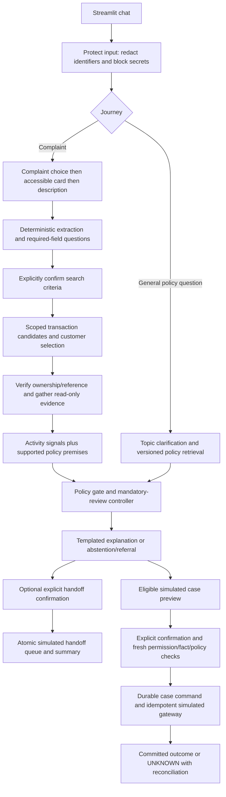

# Transaction Dispute Assistant architecture

This prototype provides evidence collection, bounded intake routing, general
policy information, a confirmed simulated handoff and confirmed simulated case
recording. It does not adjudicate chargeback eligibility, establish fraud, issue
refunds, block cards or contact a real representative. All bank records and
policies are synthetic. The reference clock is 20 October 2026.

The design starts with capabilities. Deterministic code owns the workflow and
action boundary. A local model is optional for extraction and evidence proposals;
neither use has authority to decide policy or execute an action. No agent
framework is required: ordinary functions, explicit state and durable command
records provide inspectable controls without another orchestration dependency.

For detailed component, journey, action-recovery and evaluation diagrams, see
[SYSTEM_DESIGN.md](SYSTEM_DESIGN.md).

## Output authority

These categories describe what a component may establish:

- **Suggestion:** an interpretation, candidate, customer assertion or anomaly
  signal. It cannot establish account facts or authorise an action.
- **Verified fact:** a record read from an ownership-checked synthetic bank source,
  with its source, lookup status and observation time. This means verified within
  the simulator, not independently established truth about a real payment.
- **Policy decision:** a structured result of supported deterministic rules and
  verified applicable policy. It has purpose, scope, reasons and provenance;
  it is not a permission to execute a consequential action.
- **Authorised action:** a narrowly scoped operation that passed its own explicit
  confirmation and permission checks. Completion is a separate fact established
  by committed action records or reconciliation, never by intent or a score.

Customer confirmation makes search criteria agreed customer assertions; it does
not turn the description into independently verified bank facts.

## Capability map

| Capability and implementation | Technique and why chosen | Output authority | Authoritative source | If wrong: consequence and control |
|---|---|---|---|---|
| Language understanding: `conversation.py`, `intake.py`, `concern_extraction.py` | Explicit complaint choices, regular expressions, typed date/amount normalisation; optional local source-span extractor. Small, constrained vocabulary makes rules inspectable. | Suggestion / unverified customer assertion | Customer statement for what was reported; supported fields and normalisation in code | Misread role/date could select the wrong payment. Reject invented spans, ambiguous currency, conflicting values and invalid dates; ask for missing details and confirm search. |
| Transaction identification: `domain.py` | Parameterised SQL filters on selected card, exact reference or purchase date/range, amount/currency and optional merchant substring. Deterministic ordering, no fuzzy ranking or automatic best-match choice. | Candidate suggestion, followed by verified reference/access facts | `transactions`, `accounts`, `account_access` | Wrong match or disclosure across accounts. Scope every lookup, never relax filters silently, show multiple matches and require customer selection; verify selected reference again before evidence/actions. |
| Evidence gathering: `evidence_agent.py`, `orchestration.py` | Bounded read-only gap filling, default fixed tool order, optional validated model proposal. At most eight proposal attempts per stored concern trace. | Verified records or explicit absence/failure status | Ownership-scoped transaction, merchant, receipt, cancellation, refund and credit tables | Missing or contradictory evidence could produce an unjustified conclusion. `NOT_FOUND` is not proof of absence; unavailable/malformed/forbidden results trigger verification review, and transaction verification failure stops gathering. |
| Retrieval: `policy_service.py`, `policy_contract.py` | Allowlisted topic classification plus exact topic/scope/version/date selection; manifest validation for information corpus. Small corpus does not require embedding search. | Attributed policy evidence; retrieval alone makes no account decision | Approved fictional information corpus, approved manifest and effective dates | Stale/conflicting source could mislead. Require a single active supported source, retain excluded-version attribution, abstain on ambiguity, missing authority or integrity failure. |
| Prediction/activity assessment: `activity.py`, `clustering.py` | Explainable historical amount and repeated-order checks; deterministic k-means distance with earlier fit and later calibration windows. Clustering defaults to shadow mode. | Suggestion / review signal only; never a fraud probability | Verified selected-card history plus versioned activity/clustering configuration | False positive causes unnecessary review; false negative could miss a pattern. No signal never proves safety; explicit customer risk reports independently require review. Scores have no action authority. |
| Policy execution: `conversation.finish`, `policy_contract.py`, `policy_journey.py`, `review.py`, `case_service.py` | Supported rule premises and decision tables with structured reason codes and fresh source gates. Distinct rules for intake, information and case recording. | Policy decision, or labelled operational referral when policy cannot be verified | Applicable DEMO-INTAKE, information corpus or DEMO-CASE-INTAKE, according to purpose | Incorrect route or unsupported claim. Verify scope, dates, metadata, supported rule content and premises; withhold policy conclusion on failure. Case execution independently rechecks eligibility for simulated recording. |
| Workflow control: `workflow.py`, `conversation.py`, `case_chat.py`, `review.py` | Explicit steps/allowed replies, shared turn/reopen service, separate mandatory-review, satisfaction and handoff fields | Controller transition; may carry a decision but grants no action permission | Controller code, saved concern revision, durable case command state | Skipped questions or out-of-order action. Validate at service boundary, preserve sticky review reasons, reject stale revisions, restore/reconcile durable command state on reopen. |
| Action execution: `case_service.py`, `concerns.save_note` | Deterministic preview/confirm service and transactional handoff queue; durable intent, permission checks, idempotency and audit | Authorised simulated case/queue action, then verified outcome | Current access/permission tables, current facts/policy, confirmed command and committed action ledger | Duplicate case, unauthorised submission or false success. Recheck scope/permission/expiry/facts; stable idempotency key, business duplicate guard, atomic gateway and explicit UNKNOWN reconciliation. |
| Customer communication: `conversation.py`, `policy_service.py`, `review.py`, `case_chat.py` | Fixed controller templates and retrieved clauses; no free-form generated outcome | Explanation of recorded assertions, facts, decision and action status | Decision record, verified evidence and actually consulted policy clauses | Unsupported financial promise or false completion claim. Template scope, attribution gates and recorded status constrain claims; evaluation checks provenance and selected dangerous assertions, not general semantic entailment. |
| Human continuation: `concerns.py`, `representative_ui.py`, `access.py` | Structured frozen handoff package plus separately visible later updates; scoped staff access | Confirmed simulated queue action and evidence package | Saved concern/events, evidence snapshots, policy records, action attempts | Staff might miss new information or mistake an assertion for fact. Label sections, expose missing information/interrupted step, retain history and show later updates separately. No real callback is initiated. |

## Alternatives and trade-offs

| Capability | Alternative considered | Choice and practical limit |
|---|---|---|
| Understanding | LLM-first free text or trained intent/entity model | Explicit labels and deterministic extraction avoid a training dependency. Live 135M probes produced 0% validated model field recall; retain optional evaluation, not default reliance. Rule coverage remains narrower than natural language. |
| Identification | Embedding/fuzzy merchant ranking with automatic top match | Exact filters preserve uncertainty and are easier to audit. Descriptor aliases and incomplete descriptions can require additional questions; the app does not claim sophisticated entity resolution. |
| Evidence loop | Open-ended autonomous agent | Bound proposal schema to a permitted evidence gap/reference/tool. Optional model only chooses a read proposal after ownership preflight. Default fixed order already handles the implemented branches. |
| Retrieval | Vector database and general RAG | Four known information topics permit deterministic retrieval with explicit effective dates. Unsupported legal/eligibility/deadline questions abstain. Expansion requires governed source ingestion and broader retrieval evaluation. |
| Activity | Supervised fraud classifier or anomaly score interpreted as probability | Synthetic data cannot support calibrated fraud probabilities. Rules are explainable; clustering is an optional distance signal and defaults to observation. Neither establishes authorisation. |
| Policy | Model-generated interpretation of policy prose | Explicit supported rules make premises and tests visible. This limits policy breadth; real chargeback rules, scheme deadlines and refund entitlement are not implemented. |
| Orchestration | Agent graph framework or durable external workflow engine | Plain Python state transitions suit a single-process prototype. SQLite revisions and command ledgers address tested concurrency/recovery; this is not a distributed workflow platform. |
| Action adapter | Direct real bank API calls | SQLite simulator gives reproducible confirmation/retry/failure contracts without credentials. Real authentication, adapter semantics and bank-side reconciliation remain unvalidated. |
| Explanation | Grounded generative response | Templates reduce unsupported claims and simplify tests. Language is less flexible; template correctness and evidence attribution still need review. |

## Journey and control boundaries

The diagram shows branches, not a requirement to create a case after every
explanation. A required review interrupts ordinary questions, including merchant
recognition, rather than asking for reassurance first. It remains required if
the customer declines assistance or says they are satisfied. Declining a handoff
does not authorise submission. General policy questions bypass card/transaction
lookup and can produce only in-scope evidence-collection guidance or referral.

Every complaint search is bound to the selected card and the confirmed intake
snapshot. Changing either invalidates the confirmation. Zero matches produce a
request to revise details; multiple matches remain multiple until selected.
The app does not infer an account transaction from the language model.

`workflow.process` protects input, advances the controller, gathers permitted
read evidence, applies mandatory review and saves the concern. `workflow.reopen`
restores the concern and reconciles pending case commands. UI session expiry
remains in `app.py`; customer identity is the fixed demo principal. This is an
explicit production authentication gap, not a real bank login.

## Three policy authorities

| Purpose | Source and consumer | Supported conclusion |
|---|---|---|
| Transaction intake | SQLite `policies`, DEMO-INTAKE v1.1; `policy_contract.intake` | Recognised/resolved explanation or supported referral for reported unauthorised/unresolved concerns |
| General information | `policies/corpus/dispute_information.json` and its approved manifest; `policy_service` | Four topics of attributed evidence-collection guidance; superseded versions excluded by date |
| Case recording | `policies/case_intake_v1_1.json`; `case_service` | Whether a confirmed simulated case may be recorded under the narrow demo contract |

All share attribution envelopes: purpose, scope, as-of date, status/reason,
allowed flag, sources and clauses. Sources retain identifiers, versions,
effective intervals, source locations and content hashes. Intervals include the
start and exclude the end date. They share a clock, not one universal policy
engine. Policy and administrator configuration files are trusted local assets;
hashes do not protect against an attacker replacing both source and manifest.

Customer text and merchant descriptors are data, not policy authority. Model
outputs are schema-validated proposals, not code or SQL. Tools use allowlisted
operations and parameterised queries; the evidence proposer cannot call the case
service. A case command can only come through the explicit deterministic action
path. Missing, conflicting or out-of-scope policy suppresses a policy conclusion;
verified facts and operational safety referrals may still be communicated with
that distinction intact.

## State, actions and recovery

Conversation state is a dictionary with an explicit current step, answers,
intake assertions, search confirmation, evidence, decision, review reasons and
optional case command. This is implemented branch logic, not a formally verified
transition graph. The shared service is used by both the app and workflow
harness, while action services independently enforce their own invariants.

Case command states are `PREPARED`, `CANCELLED`, `SUBMITTING`, `UNKNOWN`,
`SUCCEEDED` and `REJECTED`. A prepared command has a ten-minute confirmation
window. Execution rechecks current identity permissions, ownership, facts and
policy; a changed snapshot requires reconfirmation. Command ID is the stable
idempotency key. A unique customer/transaction registry also prevents a separate
concern creating another case for the same payment.

Intent and confirmation persist before dispatch. An ambiguous outcome is not
success: retain the same command ID, look up committed action evidence and only
then retry or report completion. A case may commit even when the subsequent
chat save fails; reopen reconciles the action ledger rather than creating a new
command. SQLite transactions provide the simulated gateway's atomicity; a future
remote bank needs its own durable idempotency/status contract.

Handoff confirmation and concern persistence commit together, with one queued
request per concern. The package separates customer assertions, selected bank
facts, evidence statuses, policy attribution, attempted actions, missing
information and escalation reasons. Later updates remain separately accessible;
the initial queued package is not silently rewritten. Automatic incident linkage
across new concerns is not implemented.

## Privacy and operational boundaries

`privacy.py` screens input before model calls/persistence. Detected secrets are
blocked; identifiers are redacted heuristically. Concern snapshots, events and
handoff payloads use Fernet encryption with locally managed or externally supplied
keys. Minimal audit metadata, revisions and event digests support traceability;
this is not a bank-grade tamper-proof external audit system. Customer downloads
use an explicit allowlist. Staff token authentication, customer scope and expiry
protect the representative view within the prototype.

Retention is an explicit administrator operation with dry run and preservation
holds; no universal retention period is assumed. Debug views are hidden by
default. Synthetic live-evaluation raw outputs are retained for failure analysis;
that practice is not approved for real customer logs. See [SECURITY.md](SECURITY.md)
for key, staff and retention setup and known limits.

## Evidence that supports these choices

- [EVALUATION.md](EVALUATION.md): 47 shared-service workflow journeys, reason codes,
  critical errors, route-specific metrics, cost framework and preserved failures.
- [LIVE_VALIDATION.md](LIVE_VALIDATION.md): 14 unchanged extraction probes pass
  deterministically after a parser fix; live model-only validated recall remains
  0%. All 186 regression tests pass. These are development/synthetic results.
- [ACTIVITY_DATA.md](ACTIVITY_DATA.md) and [DATASET.md](DATASET.md): generation,
  schemas, sampled versus constructed evidence, coverage and remaining gaps.
- [ACTIVITY_ASSESSMENT.md](ACTIVITY_ASSESSMENT.md) and [CLUSTERING.md](CLUSTERING.md):
  signal definitions, historical split and limits of activity-based routing.
- [POLICY_GATING.md](POLICY_GATING.md), [POLICY_CORPUS.md](POLICY_CORPUS.md) and
  [CASE_CREATION.md](CASE_CREATION.md): policy gates, source versioning and action
  invariants with their focused checks.

The most consequential unvalidated boundary is real bank identity, permission and
API integration. The prototype's authoritative records are local simulations.
Passing synthetic tests demonstrates the covered controls, not bank readiness,
regulatory compliance or general natural-language accuracy.
