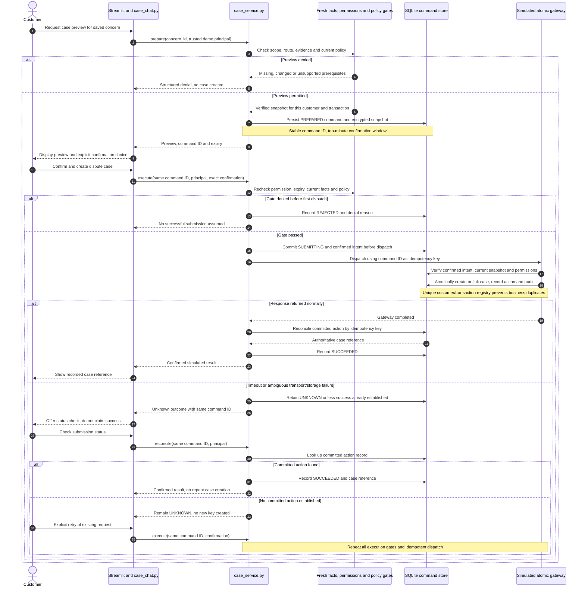
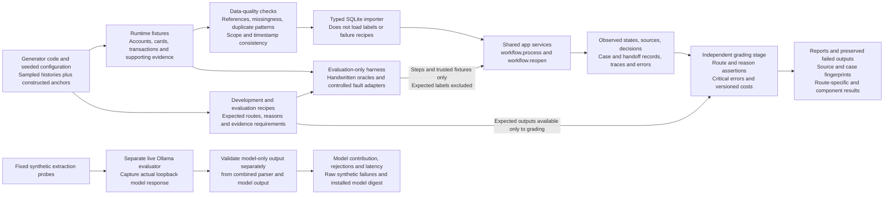

# System design graphs

These graphs describe the implemented prototype, not a proposed production bank
platform. Both extraction and evidence proposals default to deterministic code.
Optional models suggest unverified spans or permitted reads. Policies, review
requirements and actions remain under explicit controller/service checks.

Read the component graph for boundaries, the journey graph for decisions and
questions, the case sequence for transaction/retry semantics, and the evaluation
graph for what the reported results establish. GitHub renders these Mermaid
blocks directly; the labels include the implementing Python modules.

## 1. Components, data sources and authority boundaries

```mermaid
flowchart TB
    customer["Customer browser"]
    staff["Representative browser"]

    subgraph interface["Presentation boundary - Streamlit app.py"]
        chat["Customer chat and quick replies<br/>Card selection and search confirmation<br/>History download and reopen"]
        staffgate["access.py<br/>Staff token, expiry and customer scope"]
        staffview["representative_ui.py<br/>Frozen handoff, later updates and linked cases"]
    end

    subgraph control["Trusted application boundary - deterministic Python"]
        input["privacy.py<br/>Redact unnecessary identifiers<br/>Block detected authentication secrets"]
        turn["workflow.py<br/>Protected turn pipeline and reopen recovery"]
        controller["conversation.py and intake.py<br/>Explicit steps and required fields<br/>Role/date/amount validation"]
        parser["concern_extraction.py<br/>Deterministic extraction by default<br/>Customer assertions remain unverified"]
        match["domain.py<br/>Confirmed search snapshot<br/>Scoped SQL and customer selection"]
        evidence["evidence_agent.py and orchestration.py<br/>Ownership preflight, gap filling<br/>Allowlisted tools and eight-attempt budget"]
        signal["activity.py and clustering.py<br/>History-based signals<br/>Clustering defaults to shadow mode"]
        gate["policy_contract.py<br/>Source, scope, effective date and premises<br/>Structured attribution and conclusion gate"]
        review["review.py<br/>Sticky required-review reasons<br/>Independent of customer satisfaction"]
        explain["conversation.py and policy_service.py<br/>Templates and retrieved clauses<br/>Recorded reasons and action status"]
        history["concerns.py and secure_storage.py<br/>Revision checks and encrypted snapshots<br/>Events, handoff packages and audit metadata"]
    end

    subgraph model["Optional loopback model boundary - no policy or action authority"]
        ollama["Ollama smollm2:135m<br/>Optional extraction and evidence suggestions"]
        validate["Source-span and role validation<br/>Proposal schema, gap, reference and budget checks<br/>Failure falls back to deterministic processing"]
    end

    subgraph action["Separate consequential-action boundary - simulated only"]
        cardcommand["card_chat.py and card_service.py<br/>Interruptible card selection, lock or block<br/>Exact confirmation and approved policy"]
        cardledger["Card commands and atomic simulated gateway<br/>State-version guard, idempotency and audit<br/>Status reconciliation and no real card action"]
        command["case_chat.py and case_service.py<br/>Preview and explicit confirmation<br/>Fresh permission, evidence and policy checks"]
        ledger["Durable command state<br/>Stable command ID and idempotency key<br/>Status lookup and reconciliation"]
        gateway["Atomic SQLite case gateway<br/>Create or link existing simulated case<br/>Business duplicate guard and action audit"]
        queue["Confirmed simulated handoff queue<br/>One entry per concern<br/>No actual callback or external delivery"]
    end

    subgraph sources["Local authoritative sources within the simulator"]
        bank[("SQLite bank fixtures<br/>Accounts, access, transactions, merchants<br/>Receipts, cancellations, refunds and credits")]
        policies[("Four fictional policy sources<br/>SQLite intake rules<br/>Approved information corpus and manifest<br/>Case-recording JSON and approved card-control JSON")]
        config[("Versioned activity and clustering configuration")]
        records[("SQLite operational records<br/>Concerns, events, review state, handoffs<br/>Commands, cases, actions and audit records")]
        keys["Local private key or supplied Fernet key<br/>Excluded from GitHub and submission archive"]
    end

    customer --> chat
    staff --> staffgate --> staffview
    chat --> input --> turn --> controller
    controller --> parser
    parser --> controller
    controller --> match --> evidence
    match -->|"ownership-scoped reads"| bank
    evidence -->|"verified read-only records"| bank
    evidence --> signal
    signal -->|"verified prior card history"| bank
    signal --> config
    signal -->|"review signal only"| review
    controller --> gate
    evidence --> gate
    gate --> policies
    gate --> review
    review --> explain --> chat
    turn --> history --> records
    keys --> history
    controller -.->|"explicit opt-in: sanitised description"| ollama
    evidence -.->|"explicit opt-in: bounded tool metadata"| ollama
    ollama -.-> validate
    validate -.->|"unverified extraction suggestions"| parser
    validate -.->|"permitted read proposal only"| evidence
    chat -->|"card protection request or interruption"| cardcommand
    cardcommand -->|"current ownership, permission and status"| bank
    cardcommand -->|"approved source and effective date"| policies
    cardcommand --> cardledger --> records
    cardledger -->|"verified simulated outcome or UNKNOWN"| explain
    chat -->|"request preview or explicitly confirm"| command
    command --> gate
    command -->|"fresh ownership and permissions"| bank
    command --> ledger --> records
    ledger --> gateway --> records
    gateway -->|"fresh evidence recheck"| bank
    history -->|"explicit handoff confirmation"| queue --> records
    staffview -->|"authenticated scoped reads"| history
    ledger -->|"committed outcome or UNKNOWN"| explain
```

Solid arrows show application calls, data dependencies or verified-result flow;
dotted arrows show optional model interaction. A node's location describes its
responsibility, not a separate deployed microservice. SQLite bank fixtures and
operational records are logical groups in the same local database. Read tools
use read-only connections; the case service uses explicit write transactions.
The model has no connection to the action service.

**Authority ladder:** a customer/model assertion is a suggestion; a scoped lookup
can establish a simulator fact; supported policy with verified premises can
produce a decision; only separately confirmed, permitted service execution can
produce an action. Its completion still requires committed outcome evidence.

## 2. Customer journey, clarification and safe stopping

```mermaid
flowchart TD
    begin["Start customer chat"] --> issue{"Complaint or general policy question?"}
    issue -->|"Card protection or explicit interrupt"| protectcard["Select accessible card without transaction or detailed reason"]
    protectcard --> protecttype["Choose lock or permanent block<br/>Reported compromise cannot downgrade to lock"]
    protecttype --> protectconfirm["Explain effects and obtain exact confirmation<br/>Recheck card version, permission and approved policy"]
    protectconfirm --> protectresult["Simulated committed result or UNKNOWN<br/>Reconcile and retry using the same command ID"]
    protectresult --> saved
    issue -->|"Transaction complaint"| card["Select an accessible demo card"]
    card --> describe["Customer elaborates the concern"]
    describe --> protect{"Detected authentication secret?"}
    protect -->|"Yes"| blocked["Block turn before model call or saving<br/>Ask customer to remove secret"]
    blocked --> describe
    protect -->|"No: redact unnecessary identifiers"| extract["Deterministic extraction<br/>Optional validated local-model suggestions"]
    extract --> required{"Required search fields complete and valid?"}
    required -->|"No"| clarify["Ask for missing or uncertain details<br/>Keep assertions separate from bank facts"]
    clarify --> required
    required -->|"Cannot provide required information"| referral["Explain limitation and offer human assistance"]
    required -->|"Yes"| confirm{"Customer confirms search criteria?"}
    confirm -->|"Edit details"| describe
    confirm -->|"Yes"| search["Card-scoped exact SQL filters<br/>Reference or date, amount, currency and merchant"]
    search --> count{"Candidate set"}
    count -->|"None"| revise["Ask customer to revise search<br/>No invented match or silent filter relaxation"]
    revise --> describe
    count -->|"One or multiple"| choose["Customer selects the intended transaction"]
    choose --> access{"Selected reference verified for account and card?"}
    access -->|"No or lookup failure"| verification["Verification unavailable<br/>Required review; no fact assumed"]
    access -->|"Yes"| gather["Retrieve merchant and applicable policy<br/>Gather branch-specific evidence as needed"]
    gather --> assess["Compare reported assertions and retrieved evidence<br/>Assess historical activity signals"]
    assess --> risk{"Mandatory-review reason present?"}
    risk -->|"Yes"| mandatory["Interrupt ordinary follow-up questions<br/>Urgent guidance where required<br/>Preserve sticky review requirement"]
    risk -->|"No"| questions["Branch questions: recognition and authorisation<br/>Cancellation, duplicate, wrong amount or refund details"]
    questions --> decision["Evaluate supported policy premises<br/>Record route, reason codes and source attribution"]
    decision --> valid{"Applicable policy conclusion verified?"}
    valid -->|"No"| abstain["Abstain from policy conclusion<br/>Retain operational safety referral"]
    valid -->|"Yes"| outcome["Explain verified facts and supported outcome"]

    issue -->|"General policy question"| topic["Choose or clarify a supported information topic"]
    topic --> retrieve["Retrieve one applicable approved policy version<br/>Preserve clause and source attribution"]
    retrieve --> info{"Evidence present, current, in scope and consistent?"}
    info -->|"Yes"| outcome
    info -->|"No"| abstain

    mandatory --> assist{"Explicitly request human assistance?"}
    verification --> assist
    abstain --> assist
    referral --> assist
    outcome --> satisfaction["Ask resolution or assistance preference<br/>This cannot clear mandatory review"]
    satisfaction --> assist
    assist -->|"Yes"| handoff["Atomically save confirmed simulated handoff<br/>Assertions, facts, policy, attempts and missing information"]
    assist -->|"No"| retained["Save concern and preference<br/>Any required review remains required"]
    outcome --> eligible["Where supported: separate case preview<br/>Then explicit confirmation and service gates"]
    handoff --> saved["Encrypted concern and timestamped events<br/>Reopen or download minimised history"]
    retained --> saved
    eligible --> saved
```

This is a logical journey map rather than an enumeration of every internal
`step` value. In the implementation, gathering is incremental and may run after
several customer turns, within a stored concern's tool budget. Required-review
checks can interrupt those turns immediately. Case preview is an independent
option only where the case service accepts the supported concern; the graph
does not make case creation a mandatory final step.

## 3. Case confirmation, durable dispatch and unknown outcomes

A chat-save failure can occur after the case command commits. Reopening the
concern loads the durable command and reconciles it independently of the older
chat snapshot. Replaying an already successful command returns its recorded
result. Gateway rejection produces a structured denial; a gate failure on a
previously confirmed ambiguous command preserves `UNKNOWN` until reconciliation
can establish its outcome. These behaviours are implemented in `case_service.py`
and covered by timeout, replay and concurrency tests.

The sequence is specific to the simulator. A production bank gateway must
provide compatible idempotency and authoritative status lookup; a local write
cannot establish remote completion without that contract.

## 4. Reproducible data and evaluation boundaries

The executor receives no expected labels; reference labels are used afterwards
by the grader. Split isolation does not make hand-authored related families an
independent real-world benchmark. The 47 workflow journeys are offline;
separate live-model probes measure actual local inference. Their results must
not be combined into a single claim of production accuracy.

## How the graphs map to review questions

| Question | Relevant graph and implementation |
|---|---|
| Which facts come from the customer rather than the bank? | Graph 1 assertion parser versus ownership-checked evidence; `intake_assertions` and `evidence` remain separate |
| Can a model or risk score submit a case? | Graph 1 has no model-to-action edge; the action sequence requires exact confirmation and fresh service gates |
| What happens with multiple possible payments? | Graph 2 retains the candidate set and asks for customer selection |
| What if policy is stale, contradictory or unavailable? | Graph 2 blocks a policy conclusion; source scope, interval and integrity are checked by `policy_contract.py` |
| What if the customer is satisfied but review is required? | Graph 2 keeps the sticky review requirement independently of satisfaction and handoff preference |
| What if a tool or case request times out? | Graph 2 escalates evidence-verification failure; graph 3 reconciles ambiguous action state with a stable key |
| Can another engineer reproduce the evidence? | Graph 4 separates generation, runtime inputs, expected outcomes and observed results |

See [ARCHITECTURE.md](ARCHITECTURE.md) for the capability/authority matrix,
alternatives, detailed source ownership and operational limits;
[USER_GUIDE.md](USER_GUIDE.md) for running the app; and
[EVALUATION.md](EVALUATION.md) for reproducible measurements and limitations.

Card protection is the additional independently gated action path. See [CARD_PROTECTION.md](CARD_PROTECTION.md) for state transitions, initial simulator assumptions, recovery tests and limits. Models and activity scores cannot invoke it.
